# MetaShift Animals: an eight-class benchmark derived from MetaShift

This is the dataset for MetaShift Animals, associated with the paper $A^2$: Smaller Self-Supervised ViTs Localize Better than Larger Ones. It is built upon [MetaShift](https://github.com/Weixin-Liang/MetaShift). 

| | Train | Train | Test | Test |
|:---:|:---:|:---:|:---:|:---:|
| **bear** | <br>`wall` | 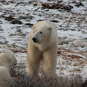<br>`grass` | 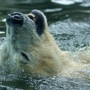<br>`water` | 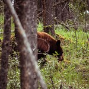<br>`trees` |
| **bird** | 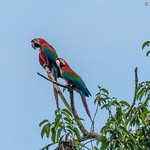<br>`sky` | <br>`water` | <br>`plant` | <br>`log` |
| **cow** | 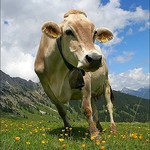<br>`collar` | 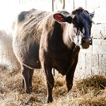<br>`hay` | 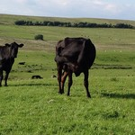<br>`trees` | 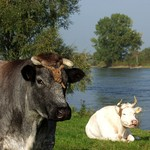<br>`rope` |
| **elephant** | 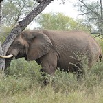<br>`tree` | <br>`rocks` | <br>`water` | 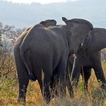<br>`leaves` |
| **giraffe** | 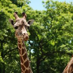<br>`tree` | <br>`water` | 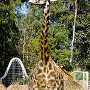<br>`wall` | 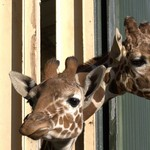<br>`ground` |
| **horse** | 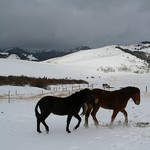<br>`mountains` | 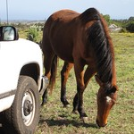<br>`truck` | 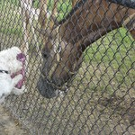<br>`animal` | 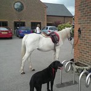<br>`bag` |
| **sheep** | 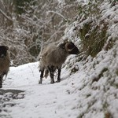<br>`ground` | 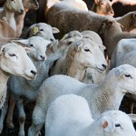<br>`lamb` | 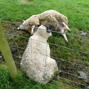<br>`grass` | 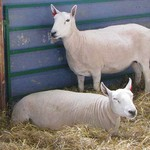<br>`hay` |
| **zebra** | 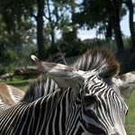<br>`fence` | 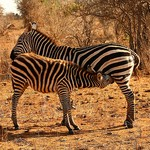<br>`bush` | 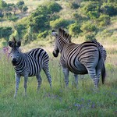<br>`grass` | 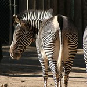<br>`dirt` |

Two training and two test images per class, labeled with their MetaShift context tag. Within each class, training and test context tags are disjoint. Images: Visual Genome (CC BY 4.0), via GQA.

```

@InProceedings{liang2022metashift,
  title={MetaShift: A Dataset of Datasets for Evaluating Contextual Distribution Shifts and Training Conflicts},
  author={Weixin Liang and James Zou},
  booktitle={International Conference on Learning Representations},
  year={2022},
  url={https://openreview.net/forum?id=MTex8qKavoS}
}

@ARTICLE{rammohan2026a2,
       author = {{Rammohan}, Sreehari and {Ha}, Huy and {Vondrick}, Carl},
        title = "{$A^2$: Smaller Self-Supervised ViTs Localize Better than Larger Ones}",
      journal = {arXiv e-prints},
     keywords = {Computer Vision and Pattern Recognition},
         year = 2026,
        month = jun,
          eid = {arXiv:2606.03148},
        pages = {arXiv:2606.03148},
          doi = {10.48550/arXiv.2606.03148},
archivePrefix = {arXiv},
       eprint = {2606.03148},
 primaryClass = {cs.CV},
       adsurl = {https://ui.adsabs.harvard.edu/abs/2026arXiv260603148R},
      adsnote = {Provided by the SAO/NASA Astrophysics Data System}
}

```

All the images and resources come from the upstream projects. 

| Split | Samples / manifest rows | Unique image IDs | Selected class–context groups |
| --- | ---: | ---: | ---: |
| Train | 3,690 | 2,385 | 75 |
| Test | 10,829 | 6,043 | 77 |

Class IDs are fixed: `0 bear`, `1 bird`, `2 cow`, `3 elephant`, `4 giraffe`, `5 horse`, `6 sheep`, `7 zebra`. There is no validation split. Report accuracy and **worst-class accuracy** over the complete test manifest, keeping repeated rows.

## Quick setup

Use Python 3.10 or newer. The dataset loader additionally needs Pillow and PyTorch. Run the commands below from this release directory.

### 1. Download the images used by MetaShift

If you already downloaded the images for MetaShift, reuse its `allImages/images` directory and skip this step. Otherwise follow the image-download step from the [official MetaShift README](https://github.com/Weixin-Liang/MetaShift#download-visual-genome):

```bash
mkdir -p /data/MetaShift
wget -c https://nlp.stanford.edu/data/gqa/images.zip -O /data/MetaShift/images.zip
unzip /data/MetaShift/images.zip -d /data/MetaShift/allImages
```

Replace `/data/MetaShift` with a writable location. The image archive is approximately 20 GB; allow additional space for extraction and the prepared subset. The resulting source directory should contain JPEGs directly:

```text
/data/MetaShift/allImages/images/
    1.jpg
    ...
    <image_id>.jpg
```

If the archive endpoint changes, use the images link on the [official GQA download page](https://cs.stanford.edu/people/dorarad/gqa/download.html). This package needs only those images. The frozen manifests already contain the selected contexts and membership, so there is no need to download scene graphs, generate full MetaShift, or install its research dependencies.

### 2. Reconstruct the exact benchmark

```bash
python prepare.py \
    --images-root /data/MetaShift/allImages/images \
    --output /data/MetaShiftAnimals

python verify.py --dataset-root /data/MetaShiftAnimals --check-hashes
```

The output path must not already exist. Preparation checks every required source image hash before writing the dataset, then verifies each copied file. Preparation **copies** the selected JPEGs and metadata; it does not move or edit source files. It preserves the original sample layout, including a separate path for each context assignment:

```text
/data/MetaShiftAnimals/
    train/<animal>/<animal(context)>/<image_id>.jpg
    test/<animal>/<animal(context)>/<image_id>.jpg
    manifests/train.csv
    manifests/test.csv
    metadata.json
```

`--check-hashes` checks image bytes against the SHA-256 values recorded from the evaluated dataset. Without that flag, image verification checks membership and file presence. Other useful checks are:

```bash
# Validate the bundled manifests without downloading or copying images.
python verify.py

# Check the original flat image directory before preparation.
python verify.py --images-root /data/MetaShift/allImages/images --check-hashes

# Also save a machine-readable verification report.
python verify.py --dataset-root /data/MetaShiftAnimals --check-hashes --report verification.json
```

### 3. Load samples with PyTorch

```bash
python -m pip install -r requirements.txt
```

```python
from metashift_animals import MetaShiftAnimals

train = MetaShiftAnimals('/data/MetaShiftAnimals', split='train')
test = MetaShiftAnimals('/data/MetaShiftAnimals', split='test', return_metadata=True)

image, label = train[0]                  # RGB PIL image and integer class ID
image, label, metadata = test[0]         # row_id, image_id, context, class_name
print(len(train), len(test))            # 3690, 10829
print(train.classes)
```

```python
from torch.utils.data import DataLoader
from torchvision import transforms
from metashift_animals import MetaShiftAnimals

transform = transforms.Compose([
    transforms.Resize(256),
    transforms.CenterCrop(224),
    transforms.ToTensor(),
])
test = MetaShiftAnimals('/data/MetaShiftAnimals', split='test', transform=transform)
loader = DataLoader(test, batch_size=64, shuffle=False, num_workers=4)
```

This transform is an example, not a prescribed benchmark preprocessing recipe. Add the normalization and other preprocessing required by your model. Keep the test loader unshuffled when aligning predictions with `test.targets`.

### 4. Evaluate

```python
from metashift_animals import evaluate_predictions

# predictions: one integer class ID per test row, in the loader's fixed order.
# For logits, first select the predicted class, e.g. logits.argmax(dim=1).
metrics = evaluate_predictions(test.targets, predictions)
print(metrics['accuracy'])
print(metrics['worst_class_accuracy'])
print(metrics['per_class_accuracy'])
```

All returned accuracies are percentages on a 0–100 scale. Worst-class accuracy is the minimum accuracy over the eight animal classes, not over class–context groups. Evaluation uses every manifest row, including repeated image IDs. Neither image deduplication nor class balancing is applied.

## Reproducibility and provenance

`manifests/train.csv` and `manifests/test.csv` define the released benchmark. Their fields are `row_id`, `split`, `image_id`, `class_id`, `class_name`, `context`, `relative_path`, and `image_sha256`. Row IDs are zero-based within each split; use `(split, row_id)` as a unique sample key. Paths are relative to the prepared dataset root. The hash identifies the unmodified source JPEG bytes. `metadata.json` records the split statistics and manifest checksums.

The original construction capped contexts at 20 per class, used a 0.5 context split ratio and seed 42, and removed test image IDs from training.

## Validation

Run the loader and metric checks after installing the requirements:

```bash
python -m unittest discover -s tests -v
```

## Attribution and licenses

Please cite **MetaShift** as well, the bibtex is shown above.